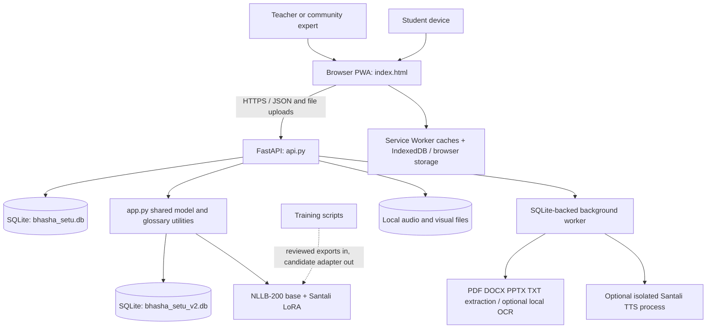

# Bhasha Setu Project Report

**Analysis date:** 15 October 2026  
**Scope:** Source-code and project-document inspection. This report describes the checked-in implementation; it is not a new classroom-quality or model-accuracy certification.

## 1. Executive summary

Bhasha Setu is a Python/FastAPI service with a browser-based installable PWA for preparing Hindi or English school material in Santali, Ho, and Mundari. Its central workflow combines a machine draft where a model exists with separate teacher and community-language-expert checks. Only content that passes the required reviews is exposed to students.

The project has different capabilities by language:

| Language | Curriculum translation | Reviewed lessons and lookup |
|---|---|---|
| Santali | Hindi-to-Santali draft using NLLB-200 and a LoRA adapter; target tag is `sat_Beng` (Bengali-script setting). An experimental English-to-Hindi-to-Santali bridge is also available, with no verified classroom accuracy benchmark. | Two-role reviewed lessons and complete translated documents; optional generated speech and human audio; reviewed still images. |
| Ho | No machine-translation model. PDF text can become a human-translation task. | Human-produced, two-role reviewed lesson pairs and a separately reviewed Hindi-word lookup. Human audio recording is supported. |
| Mundari | No machine-translation model. PDF text can become a human-translation task. | Human-produced, two-role reviewed lesson pairs and a separately reviewed Hindi-word lookup. Human audio recording is supported. |

This is not a three-language machine-translation system. It is a supervised pilot: Santali gets model-assisted drafts, and Ho/Mundari rely on fluent speakers. Student learning content can be cached for offline use, but translation, review, uploads, and server-side processing require a connection to the school server.

## 2. Architecture



### Main source files

- `index.html`: single-page browser interface, CSS and JavaScript; tab navigation, reviewer forms, student lessons, browser speech, upload retries, local saving, and API calls.
- `api.py`: primary FastAPI server; role login, translation/review endpoints, PDF jobs, human Ho/Mundari lesson corpus, audio, visuals, exports, and student API.
- `app.py`: shared NLLB translation/model loader and Ho/Mundari glossary storage and utilities. It also contains older document and HTTP-server code; its main entry point directs users to run `api.py`.
- `santali_tts.py`: optional worker process for on-demand Santali speech generation.
- `training/backtranslate_santali.py`: creates unvalidated Santali-to-Hindi candidate pairs.
- `training/train_santali_adapter.py`: trains a separate candidate LoRA adapter from approved data and evaluates it against a holdout set.
- `vocab/ho_hindi_pairs_raw.csv`, `vocab/mundari_pairs_raw.csv`: seed word lists, loaded into the glossary store as pending review entries.
- `lora_santali/`: the included LoRA adapter weights and configuration.

### Data storage

- `bhasha_setu.db`: FastAPI lesson drafts, review rounds, PDF/document jobs and sections, human Ho/Mundari sentence pairs, audio/visual review state, and correction flags.
- `bhasha_setu_v2.db`: shared-core store used for Ho/Mundari glossary word pairs and their reviews. `app.py` creates and seeds this database when imported.
- `audio_recordings/`, `lesson_visuals/`, `.pdf_staging/`, `.student_pdf_cache/`: local media, temporary source files, and generated-PDF cache. A staged source file is removed after extraction; extracted text and filename/page or slide provenance remain. Student PDFs are rebuilt from the saved Santali draft or approved text after a restore.
- The SQLite files and media folders are local to the school server. Student offline caches live separately in each browser.

## 3. User-facing features

The page has **Learn**, **Review**, **Study materials**, **Audio**, **Visuals**, **Progress**, **Ho and Mundari words**, and **Ho/Mundari sentences** areas.

### Student learning

- Browse/search available reviewed Santali lessons and approved human-produced Ho/Mundari lessons.
- Save approved content and PDF sections locally; adjust text size and high contrast.
- Use a matching language voice installed in the browser through the Web Speech API when available. The code avoids substituting a different language voice.
- Play approved lesson recordings and see approved lesson illustrations where supplied.
- Offline lesson text, word lookup, and previously cached approved media can remain available without a server connection.

### School data backup

- A signed-in teacher or community expert can download a ZIP from **Progress** containing SQLite snapshots of both school databases and saved lesson audio and visual files.
- The archive includes a manifest with creation time and media counts. It excludes model weights, secrets, staged PDF files, and student-device caches; restore instructions are in `README.md`.
- The ZIP is not encrypted. It can contain review history and unpublished lesson text, so staff should store it in a secure location separate from the school server.

### Translation review and corrections

- Reviewer signs in using either the teacher role or the community-expert role.
- Santali translation drafts are ordered using a model score as a review-priority signal. The score is explicitly not calibrated as a probability of correctness.
- One reviewer sees Hindi and an editable Santali candidate; by default, a single approval publishes the lesson. Set `BS_REQUIRED_REVIEWERS=2` to require both roles.
- If two-role review is configured and a reviewer changes the candidate, the changed version requires both roles to check it again.
- A reviewer can reopen a published lesson with a reason. It is hidden from student sync and returned through a new review round using the configured Santali reviewer count.
- Approved sentence data can be exported as JSONL with reviewer-role and edit provenance.

### PDF curriculum workflow

1. A signed-in reviewer uploads a PDF, DOCX, PPTX, or UTF-8 TXT file (20 MB maximum, 120 PDF pages/PPTX slides, 2,000 extracted sections, and 120 MB maximum expanded office package).
2. A background job extracts text in source order. PDF pages without selectable text can use local OCR if the optional Python wrappers, Tesseract executable, and the matching Hindi `hin` or English `eng` data are installed. DOCX paragraphs and PPTX slide text are extracted; images and tables are not included.
3. Extracted text is split into reviewable sections with filename and page/slide/section provenance. Each section stays separately reviewable.
4. Hindi-to-Santali uses the installed model. English-to-Santali uses a two-stage English-to-Hindi then Hindi-to-Santali model path; the original English and intermediate Hindi are shown to reviewers. This English bridge is experimental and has no verified curriculum-accuracy benchmark. Ho/Mundari Hindi sections enter the human-translation queue with the requested writing system; English source is currently not accepted for these two languages.
5. When all Santali model drafts are ready, **Learn → Complete translated documents** exposes one server-generated PDF labeled as an AI draft. Each original Hindi or English section is followed by the corresponding Santali draft, so students can compare them while reviewers check the text. After the configured Santali reviewer count approves every section, the student library offers the reviewed version. Ho and Mundari PDFs remain gated on human translation and approval. PyMuPDF reflows ordered bilingual sections continuously and supports complex-script shaping; source layout, images, tables, exact typography, and page formatting are not reproduced.
6. The generated PDF is streamed to students and cached by the service worker after an online open, allowing that document URL to be read offline on that browser. Browser storage may be cleared and is not a backup. If an upload is interrupted, the browser retains the file, source language, target language, and writing-system choice in an IndexedDB outbox and retries when connectivity and reviewer login return.

OCR is optional and local; it is not enabled merely by installing the Python wrapper packages. OCR output is source text to verify, not a translation or reviewed lesson.

### Ho/Mundari words and sentence corpus

- CSV seed words start pending; the public lookup returns only word pairs both roles approved.
- Reviewers can add, correct, reject, reopen, and export word pairs.
- For sentences, reviewers can submit Hindi source text for human translation or contribute an existing translation, with writing system and source note.
- The other role must approve the same source, target, writing system, and source note before publication.
- Approved human sentence pairs export separately from the Santali machine-translation training corpus.

### Audio

- After the Santali text has both approvals, a reviewer may request an AI speech draft, record a reading in the browser, or upload a clip.
- A different reviewer role must listen to the complete clip before approving it. The backend also requires the submitted audio transcript to match the currently approved text.
- Human audio upload/review is also implemented for Ho/Mundari community lessons. Those languages have no generated-speech model here.
- Approved recordings can be cached on student devices. Media is stored locally by the server.

### Visuals

- A reviewer can upload a school-approved still image for an approved Santali lesson, with accessible description and source credit.
- The server normalizes/resizes the image and stores a JPEG; another role must inspect the image and description before it reaches students.
- Translation changes invalidate affected review state and stale media so a checked asset does not silently remain attached to changed wording.
- This is a human-supplied image workflow. There is no image-generation model or automatic illustration pipeline.

## 4. Models and algorithms

### Translation model

- **Base:** `facebook/nllb-200-distilled-600M` through Hugging Face Transformers.
- **Adapter:** PEFT LoRA adapter in `lora_santali/`, configured with rank 8, alpha 32, dropout 0.05, and `q_proj`/`v_proj` target modules.
- **Direction/tags:** Hindi Devanagari `hin_Deva` to the Santali Bengali-script tag `sat_Beng`.
- **Runtime:** PyTorch and a SentencePiece-backed tokenizer; the current inference loader keeps NLLB on the server's default CPU device. The training and optional speech scripts have separate device selection.
- **Long text handling:** sentences are split at word boundaries to keep model inputs within configured token limits. PDF translation batches use size two to moderate CPU memory use.
- **Score:** generated token scores are combined as a low-piece confidence signal for triage. The project documentation correctly warns that it is not a calibrated correctness probability.
- **Quality evidence:** the original adapter training corpus and original evaluation report are absent. The current adapter's quality and writing-system accuracy cannot be independently reproduced from this repository.

### Speech

- **Optional model:** `ai4bharat/indic-parler-tts` via Parler-TTS, configured in `santali_tts.py` to generate a Bengali-script Santali reading. It is separate from the translation adapter.
- Model loading happens only after a reviewer asks for generation; a helper process isolates it from the web server. The API stops/unloads the translation resource before speech generation to reduce peak memory pressure.
- First generation requires the optional dependencies, internet/model cache, and Hugging Face access accepted for the model. Generated pronunciation for this project's Santali text has not been independently validated; every clip remains a draft pending another reviewer.
- Browser-native Web Speech voices are another option on supported devices. They are installed-device voices, not a bundled Bhasha Setu model.

### Training and back-translation

- `backtranslate_santali.py` uses the NLLB base model in reverse (`sat_Beng` to `hin_Deva`) and marks each generated pair `synthetic: true` and `human_validated: false`.
- `train_santali_adapter.py` requires two-role reviewed human rows, at least 50 unique human training pairs and at least 25 separate holdout pairs, rejects source overlap, and only accepts synthetic pairs when separately marked human-validated and dual-reviewed.
- It compares base/current/candidate chrF, records data fingerprints and training settings, and saves a **new candidate directory**. It does not overwrite or deploy the live adapter automatically.
- Because the original adapter dataset is missing, the pipeline cannot prove that a newly chosen holdout set was never seen by the original adapter.

## 5. Libraries and platform APIs

| Area | Libraries / APIs | Use |
|---|---|---|
| Web backend | FastAPI, Uvicorn, Pydantic, `python-multipart` | HTTP API, request validation, server, multipart uploads. |
| Translation | PyTorch, Transformers, PEFT, SentencePiece | NLLB inference and LoRA adapter. |
| Persistent data | Python `sqlite3` | Local review, glossary, and PDF-job databases. |
| Document extraction and PDF output | `pypdf`, `python-docx`, `python-pptx`, PyMuPDF `Story` | PDF/Word/PowerPoint/TXT text ingestion, plus an ordered, flowing student PDF with complex-script shaping. |
| Optional scanned-PDF OCR | `pypdfium2`, `pytesseract`, Pillow, Tesseract with Hindi data | Render scanned pages and run local OCR. |
| Visual processing | Pillow | Validate, resize, normalize, and strip metadata by re-encoding uploads. |
| Optional generated audio | `parler-tts`, Transformers, PyTorch, Accelerate, NumPy, SoundFile | Generate WAV speech on the school server. |
| Training evaluation | SacreBLEU `CHRF` | Candidate screening metric on separate reviewed holdout data. |
| Browser app | HTML, CSS, plain JavaScript; Service Worker/Cache API, IndexedDB, localStorage, Web Speech API, MediaRecorder | Installable PWA, offline caching/outbox, settings, read-aloud, and browser recording. |

There is no React Native application or Node/npm dependency tree in the current project. The front end is a web PWA in one `index.html` file.

## 6. Security and deployment behavior

- Server binds to loopback by default. A classroom LAN deployment must configure a trusted TLS certificate/key; FastAPI rejects non-loopback HTTP requests.
- `BS_TEACHER_PIN` and `BS_EXPERT_PIN` must be distinct values, each at least eight characters. The server limits repeated failed logins, and reviewer API calls require a bearer token.
- Reviewer tokens are held in process memory, so a server restart ends active sessions. The role setup is a shared-passcode supervised pilot, not named individual accounts or production identity management.
- PDFs and media are processed/stored on the school server; the OCR path is local. TTS weights are fetched from Hugging Face on first use when not cached. Keep `HF_TOKEN` private and do not commit it.
- Other-device PWA access requires HTTPS for microphone/service-worker features and secure handling of school data.

## 7. Requirement coverage and remaining gaps

| Requirement in the project brief | Current implementation / gap |
|---|---|
| AI-assisted Hindi-to-tribal-language curriculum | Implemented for Santali drafts only. Ho/Mundari are human translation queues; no Ho/Mundari MT model. |
| Teacher + community validation | Santali text can use one reviewer by default or two roles with `BS_REQUIRED_REVIEWERS=2`; Ho/Mundari lessons and word pairs retain both-role validation. Recordings and visuals require a separate reviewer. |
| Whole-document curriculum ingestion | Implemented for PDF, DOCX, PPTX, and UTF-8 TXT with page/slide/section tracking and async processing. English-to-Santali is an experimental English-to-Hindi-to-Santali bridge; Ho/Mundari documents require Hindi input and human translation. OCR requires additional local system installation. |
| One complete student PDF | Implemented as a continuously reflowed bilingual PDF: each original Hindi or English section is followed by its Santali AI draft as soon as all sections finish translation, then the reviewed version after the configured Santali reviewer count approves every section. Ho/Mundari PDFs require human translation and review. Original page layout, images, and table structure are not retained; extracted table text flows as regular text. PDFs are cached by the service worker after opening online; offline availability depends on browser storage. |
| Offline-first learning | Implemented for app shell and approved content/media caches; not for server-side translation, review, PDF extraction, or generation. |
| TTS | Optional Santali model generation plus installed browser voices; no bundled offline TTS model for Ho/Mundari. Model speech quality for Santali must be evaluated by fluent speakers. |
| Visual learning support | Reviewed, manually uploaded still images; no AI image generation. |
| Active learning / confidence review | Lower-score-first reviewer queue and review analytics exist; confidence is an uncalibrated signal. No automated active-learning trainer. |
| Transfer learning and back-translation | Scripts exist for a controlled candidate-training workflow. Data review is required; training/deployment is not automatic. |
| React Native/PWA frontend | PWA is implemented. No React Native app. |
| Real-time translation | A local server can draft short Santali input; there is no streaming translation and no machine translation for Ho/Mundari. PDF work uses a queue. |
| Automated tests and evaluation | A set of test files was not visible in the project inventory. The bundled adapter's original corpus/evaluation is missing; no benchmark can be verified from this repository alone. |

## 8. Important implementation notes

1. **Two databases are present and easy to confuse.** The FastAPI lesson/review system writes `bhasha_setu.db`; `app.py` imports/uses `bhasha_setu_v2.db` for the shared glossary data and CSV seed. Back up both databases and media directories.
2. **Run `python api.py` for the documented application.** Do not start the project by running `app.py`; its main block points to the FastAPI entry point.
3. **The PWA is a client, not the AI runtime.** Approved content can be cached on student devices, but the NLLB model and PDF/audio jobs execute on the school server.
4. **Writing system matters.** The shipped Santali adapter uses the Bengali-script `sat_Beng` configuration; it must not be described as Ol Chiki output.
5. **This is not yet a production deployment.** Shared reviewer passcodes, lack of individual accounts, unverified original model data, small Ho/Mundari word lists, optional local OCR setup, and unvalidated TTS pronunciation are material pilot limitations. The backup download protects the local databases and stored lesson media, but it is manual and the ZIP is not encrypted.

## 9. Useful project commands

Install the required app packages and start the FastAPI service from PowerShell with the two private passcodes set in that same session:

```powershell
python -m pip install -r requirements.txt
$env:BS_TEACHER_PIN = "<private teacher passcode>"
$env:BS_EXPERT_PIN = "<different private expert passcode>"
python api.py
```

Optional dependencies are in `requirements-ocr.txt` and `requirements-tts.txt`. Tesseract itself and Hindi language data are installed separately from the OCR Python packages. Training dependencies are in `requirements-training.txt`; training requires approved export and holdout files prepared according to `training/README.md`.

## 10. Overall assessment

Bhasha Setu uses human review for finalized lessons and media, and makes clearly labeled Santali document drafts available to students as soon as model translation finishes. This supports early access while keeping draft and reviewed PDF status visible. It also has substantive offline caching, PDF intake, correction, media review, and data-export paths. The strongest truthful description is **an offline-capable curriculum pilot with student-accessible Santali AI draft PDFs, Santali lessons approved by the configured reviewer count, and human-powered Ho/Mundari content**. Building and validating actual Ho/Mundari machine-translation models, confirming the Santali TTS quality, proving model quality on a clean held-out corpus, and hardening user identity/deployment remain future work.
